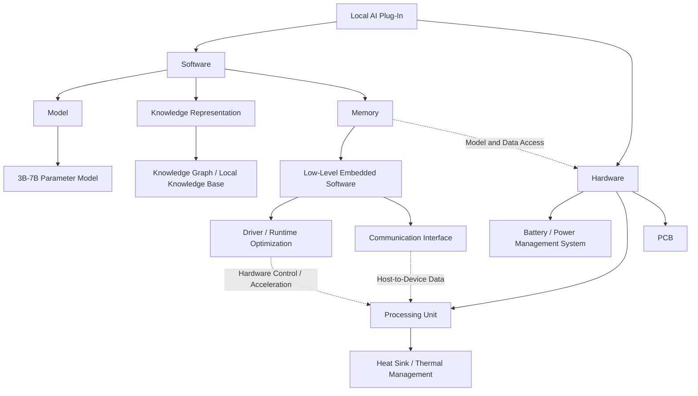

# Local AI Plug-In Architecture

## Overview

This project is a **portable Local AI Plug-In** designed to run a small language model locally instead of relying on a remote data center or cloud service. The goal is to create a modular hardware device that can connect to a host computer and offload AI inference workloads from the host CPU/GPU.

The system is split into two major areas:

- **Software**
- **Hardware**

The software stack handles the AI model, local knowledge, memory, drivers, and host communication. The hardware stack provides the processing resources, power management, thermal management, and physical PCB implementation needed to run the system as a self-contained module.

A target starting point for the project is a **3B–7B parameter model**, with future versions scaling based on processing capability, memory capacity, power, and thermal limits.

---

## High-Level Architecture



---

# Software Architecture

## 1. AI Model

The AI model is the primary workload executed on the device.

### Initial Target

- **Model size:** approximately **3B–7B parameters**
- **Primary function:** local language-model inference
- **Future goal:** support different models depending on available memory and compute resources

The exact model size will depend on:

- Available RAM / VRAM
- Storage capacity
- Processing throughput
- Quantization level
- Power consumption
- Thermal constraints

Quantized models may be used to reduce memory requirements and increase inference speed.

---

## 2. Knowledge Representation

The system can include a local knowledge layer to provide the LLM with information that is not contained directly in the base model.

Possible implementations include:

- Knowledge Graphs
- Local document databases
- Vector databases
- Retrieval-Augmented Generation (RAG)
- User-provided files or datasets

This allows the plug-in to provide **localized and specialized knowledge without requiring an internet connection**.

### Example

```text
User Query
    |
    v
Local Knowledge Search
    |
    v
Relevant Context
    |
    v
LLM Inference
    |
    v
Generated Response
```

---

## 3. Memory

Memory is responsible for storing and accessing the information required by the AI system.

This may include:

- Model weights
- KV cache
- Temporary inference data
- Knowledge-base information
- User session data
- Firmware and software
- Configuration data

Memory architecture will be one of the major design constraints because larger models require significantly more memory.

Possible memory technologies could include:

- LPDDR
- DDR
- High-speed embedded memory
- Flash storage
- NVMe storage

---

## 4. Low-Level Embedded Software

The embedded software acts as the bridge between the AI software stack and the physical hardware.

Responsibilities may include:

- Hardware initialization
- Memory management
- Communication with the host PC
- Power monitoring
- Thermal monitoring
- Processing-unit control
- Model loading
- Inference scheduling

---

## 5. Driver and Runtime Optimization

The driver/runtime layer allows the host computer and the AI plug-in to communicate efficiently.

Possible responsibilities include:

- Device detection
- Data transfer
- Memory allocation
- AI workload scheduling
- Hardware acceleration
- DMA transfers
- Runtime optimization
- Model execution control

The long-term goal is for the device to behave similarly to another compute accelerator installed in or connected to a computer.

---

## 6. Communication Interface

The communication system transfers prompts, model data, commands, and generated results between the host computer and the Local AI Plug-In.

Possible interfaces include:

- USB
- USB4
- Thunderbolt
- PCIe
- Ethernet

### Basic Data Flow

```text
Host Computer
     |
     | Prompt / AI Workload
     v
Local AI Plug-In
     |
     | Local Processing
     v
Generated Result
     |
     v
Host Computer
```

A future version of the architecture could move from an external plug-in device to an **internal PCIe-style accelerator card**.

---

# Hardware Architecture

## 1. Processing Unit

The processing unit performs the primary AI inference calculations.

Possible hardware platforms include:

- GPU
- NPU
- FPGA
- AI accelerator ASIC
- SoC
- Heterogeneous CPU + accelerator architecture

The processing unit should be optimized for operations commonly used in neural networks, such as:

- Matrix multiplication
- Vector operations
- Attention calculations
- Quantized arithmetic
- Parallel tensor processing

---

## 2. Battery / Power Management System

The power-management system regulates and distributes power throughout the device.

Responsibilities may include:

- Voltage regulation
- Current monitoring
- Battery monitoring
- Over-current protection
- Under-voltage protection
- Temperature monitoring
- Power sequencing

Depending on the final design, the device may either:

1. Receive power directly from the host computer, or
2. Include a local battery for portable operation.

---

## 3. Thermal Management

AI workloads can create significant heat, so the processing unit requires a thermal-management system.

Possible solutions include:

- Passive heat sink
- Active fan cooling
- Heat pipes
- Vapor chamber
- Thermal pads

The cooling solution should balance:

- Device size
- Weight
- Noise
- Power consumption
- Maximum processor temperature
- Sustained inference performance

Thermal design will directly affect how long the accelerator can operate at full performance without throttling.

---

## 4. PCB

The PCB integrates the major hardware components of the Local AI Plug-In.

Potential PCB components include:

- AI processing unit
- Memory
- Storage
- Power-management circuitry
- Voltage regulators
- Communication controller
- Sensors
- Debug connections
- Host interface
- Thermal monitoring circuitry

A custom PCB would allow the complete system to be packaged into a compact and portable form factor.

---

# Software-Hardware Interface

The software and hardware portions of the system must work together closely.

The embedded/runtime layer will communicate with the processing unit to:

1. Load the AI model.
2. Allocate memory.
3. Transfer input data.
4. Start inference.
5. Monitor processing status.
6. Retrieve generated output.
7. Return the result to the host PC.

```text
Application / User
        |
        v
Host Software
        |
        v
Device Driver
        |
        v
Communication Interface
        |
        v
Embedded Runtime
        |
        v
AI Processing Unit
        |
        v
Memory
        |
        v
Model Inference
```

---

# Example System Operation

A typical request could follow this process:

1. The user enters a prompt on the host computer.
2. Host software sends the request to the Local AI Plug-In.
3. The embedded runtime receives the request.
4. If necessary, the system searches the local knowledge base.
5. Relevant information is added to the model context.
6. The processing unit executes the AI model.
7. The generated tokens are returned through the communication interface.
8. The host computer displays the final response.

---

# Design Goals

The Local AI Plug-In is intended to focus on the following goals:

| Goal | Description |
|---|---|
| **Local Processing** | AI inference should run without requiring cloud compute. |
| **Privacy** | Sensitive prompts and data can remain on the local device. |
| **Portability** | The system should be compact and easy to connect to different computers. |
| **Modularity** | Hardware and software components should be replaceable or upgradeable. |
| **Low Cost** | The architecture should target a lower-cost alternative to large AI workstations. |
| **Low Power** | The system should minimize energy use while maintaining useful AI performance. |
| **Offline Operation** | Core AI functionality should remain available without internet access. |
| **Host Offloading** | AI computation should be moved away from the host CPU whenever possible. |

---

# Future Development

Potential future improvements include:

- Larger language-model support
- More advanced model quantization
- Dedicated FPGA or ASIC acceleration
- PCIe motherboard integration
- Additional RAM
- Faster model storage
- Multi-model support
- Local RAG database
- Secure encrypted storage
- Automatic model loading
- Hardware monitoring software
- Custom cooling solution
- Custom PCB
- Dedicated host-side application
- API support for third-party software

A long-term goal could be to make the Local AI Plug-In a **standard computer accelerator**, similar in concept to how GPUs became specialized hardware for graphics and later parallel computing.

---

# Proposed Repository Structure

```text
local-ai-plugin/
│
├── README.md
│
├── hardware/
│   ├── pcb/
│   ├── power/
│   ├── thermal/
│   └── processing_unit/
│
├── firmware/
│   ├── drivers/
│   ├── communication/
│   └── memory/
│
├── software/
│   ├── runtime/
│   ├── host_interface/
│   ├── model_loader/
│   └── knowledge_base/
│
├── models/
│   └── model_config/
│
├── docs/
│   ├── architecture/
│   ├── requirements/
│   └── testing/
│
└── tests/
```

---

# Current Architecture Status

This repository currently represents the **conceptual architecture** of the Local AI Plug-In.

The next major design decisions are expected to include:

- Selecting the processing platform
- Selecting the initial 3B–7B model
- Determining memory requirements
- Choosing the host communication interface
- Developing the embedded runtime
- Determining power requirements
- Designing the thermal solution
- Creating the first hardware prototype

---

## Project Vision

The goal of this project is to explore whether local AI acceleration can become a **small, modular piece of computing hardware** that users can add to an existing computer.

Instead of sending every AI request to a remote data center or forcing the host CPU/GPU to handle the full AI workload, the Local AI Plug-In provides a dedicated platform for **private, offline, and efficient AI inference**.
